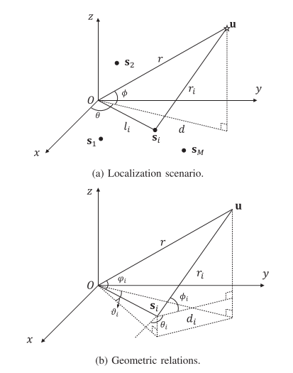
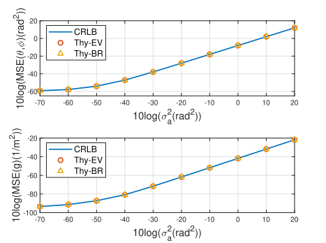
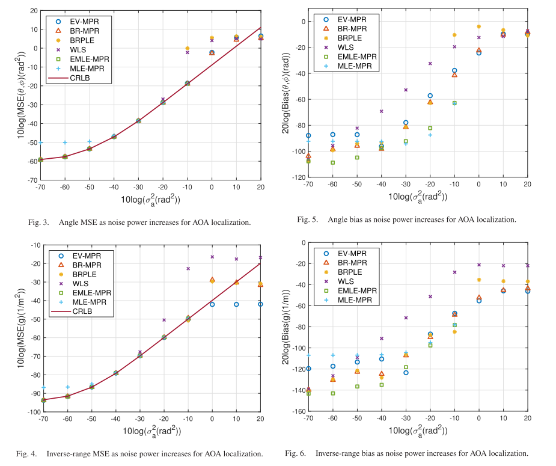
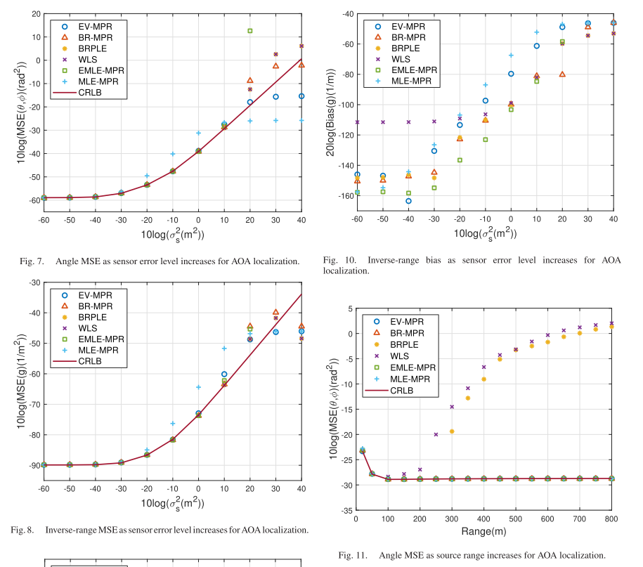
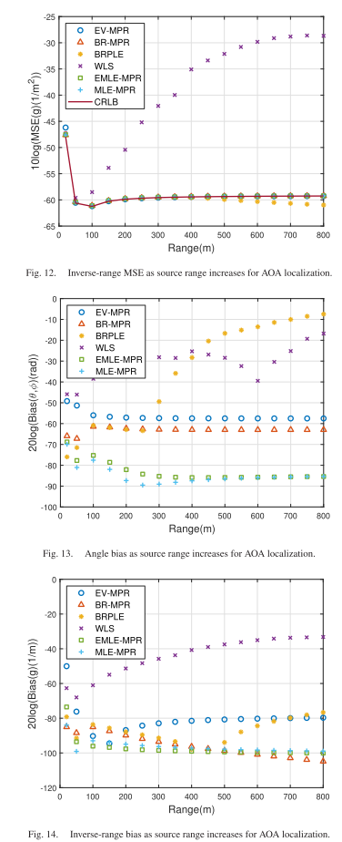
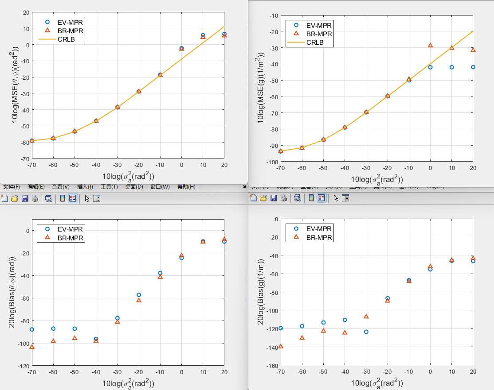

# [AOA Estimation] Correcting the Localized Feature Space Solution in Polar Coordinate Representation for AOA [with MATLAB Code]

Introduction: Localization of radiation sources is a classic problem, yet it remains an active research area in both the scientific and engineering communities [1]-[7]. The applications and requirements for localization have expanded to various location-based services, including the Internet of Things (IoT) [3], unmanned aerial vehicles (UAVs) [4], emergency services [5], autonomous vehicles [6], and next-generation communication systems [7].
Localization involves obtaining positioning parameters and solving a set of equations to determine the source's position. Perhaps the most common form of positioning parameters is passive or non-cooperative angle of arrival (AOA) and time difference of arrival (TDOA). AOA is obtained using a small sensor array at each receiver to measure the source signal's arrival angle. Lines intersecting from different sensors' AOAs define the source's estimated position [8]-[10]. TDOA generates the arrival time difference between the source signal and a reference sensor, which is then used to derive the source's position through intersections on a hyperbola defined by the TDOA [11]-[13]. The accuracy of TDOA is directly proportional to the bandwidth of the received signals, while AOA accuracy is less affected by it [14]-[16]. TDOA measurements often offer higher capture precision than AOA, especially when the signal bandwidth is large. Therefore, AOA localization performance is generally inferior to TDOA. It provides greater flexibility by avoiding sensor synchronization. Both positioning parameters can be applied together to achieve better accuracy [17]-[20], provided that sensors are synchronized and capable of obtaining both parameters.
Although the concept of localization is simple, determining accurate and robust positions from positioning parameters is quite challenging. Controlling the relationship between the positioning parameters and unknown variables is highly nonlinear. Extensive research efforts have been made to obtain effective estimates for AOA [18]-[27] and TDOA [13]-[32], with their computational requirements and statistical performance fitting practical applications and achieving reasonable solutions in noisy environments with multipath propagation [29]-[33].
The positioning always assumes the availability of knowledge, if the source is modeled as a point at a near-field source position or in a far-field, it can only be characterized by the direction of arrival (DOA). Knowledge makes appropriate processing of point positioning and DOA estimation using different data and their algorithms incompatible with each other. Using point positioning for far-field sources [11], [31], [32] algorithms will produce DOA mean position estimation errors. Applying DOA estimation [34]-[36] to near-field sources will cause a large amount of DOA bias [37], [38], not to mention ignoring source range information, which can be recognized. There have been some works on near-field DOA estimation using the Fresnel approximation [39], [40]; however, the approximation error may be significant. In practice, prior knowledge about whether the source is near or far is often impossible to obtain.
[37] was probably the first introduction of modified polar coordinate representation (MPR) that could integrate point positioning and DOA estimation into a single framework, which could lead to an estimator that can operate properly without knowing whether the source is near or far. MPR uses angles and distances to define the source position, instead of the usual Cartesian coordinates. If the source is exactly nearby, the estimator using MPR automatically gives the point position; if the source is exactly far away, the estimator using MPR automatically gives the DOA. The initial work [37] was used for TDOA measurements. In [38], [41], the study was extended to AOA observations. [38] considered general formulas suitable for both two-dimensional and three-dimensional scenarios, and [41] gave a simplified version of two-dimensional attack angle positioning in MPR. However, previous works [37], [38], [41] only provided iterative maximum likelihood estimation with coarse semidefinite relaxation as initial values. ML estimators have high computational complexity, and SDR initial solutions may not be sufficient to ensure global convergence. Moreover, their solutions assume that the sensor position is completely known.
Recent work [42] developed an algebraic estimator for source localization in MPR when the localization parameters are TDOA. Two solutions were proposed: one is the more straightforward but less complex closed-form solution SUM using continuous unconstrained optimization. The other is the GTRS solution, which applies Lagrangian methods for constrained optimization. Subsequent work [43] improved the MPR SUM solution by reducing estimation biases. [44] verified that the MPR model achieves consistent source localization with real data collection both in near and far fields, and derived an SDR solution that can achieve Cramer-Rao Lower Bound (CRLB) performance. The algebraic estimator in MPR is only established for TDOA and does not apply to other types of localization parameters, nor does it consider sensor position errors.
This paper primarily studies the development of algebraic solutions for AOA localization problems in MPR, adopting a new formula that takes into account sensor position errors. AOA is fundamentally different from TDOA and generates different forms of localization surfaces. Direct application of SUM or GTRS techniques for AOA localization is not feasible. One complexity of AOA localization is that it is known, especially with pseudo-linear formulas, leading to significant estimation biases. It is crucial to minimize biases [45].
We also conducted first-order analysis of these two solutions using vector space methods, deriving their theoretical covariance matrices. Their performance reaches the CRLB under Gaussian noise in a small error region. Compared to existing algebraic solutions, the algorithm proposed in this paper provides stable and precise angle estimates when the source is located at a distance, while maintaining comparable performance when the source is close to the receiver.
Figure 1. Localized geometric figures.
Figure 2. Analysis of MSE compared to CRLB.
Conclusion: This paper proposes a formula and develops two algebraic solutions for MPR AOA positioning considering sensor positioning error. Both solutions utilize constrained feature space techniques, depending on the constraints applied. The first solution requires less computation, while the second has a smaller deviation. For MPR AOA positioning, the proposed solutions are novel and more computationally attractive than previous iterative solutions, assuming that sensor positioning errors do not exist. Compared to other closed-form algorithms for AOA positioning, which can only work with near-field sources, the proposed solutions provide stable angle and reverse distance estimates regardless of whether the source is close or far from the sensor. The proposed solutions have been theoretically evaluated using first-order analysis. Simulation results validate the good performance of the proposed solutions in achieving Gaussian noise CRLB accuracy within small error regions, as well as computational advantages over iterative AOA MPR solutions.
MATLAB code simulation results

## Images

<!-- PAYMENT_BLOCK -->

## Get this dataset

- Payment link (Stripe): [Buy now](https://buy.stripe.com/3cs8yP7sY87d0vu9AB)
- Payment QR code: 

<!-- /PAYMENT_BLOCK -->
